# Rangkuman Konfigurasi GNS3 
## Metode CIDR

## Penggabungan map 
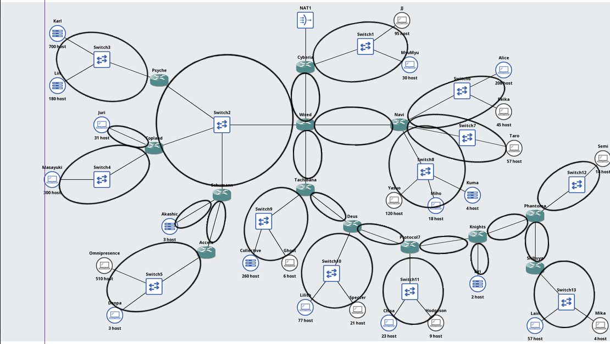
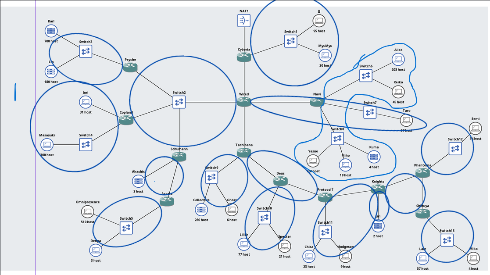
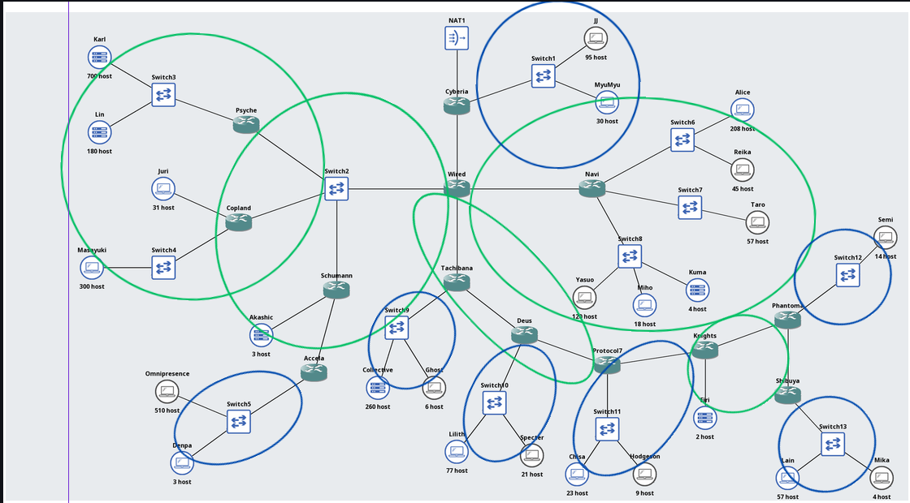
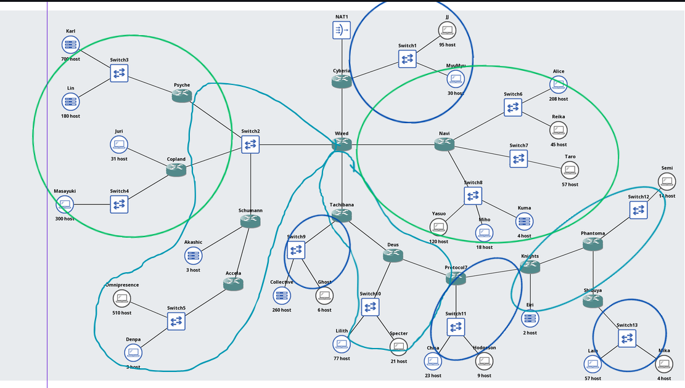
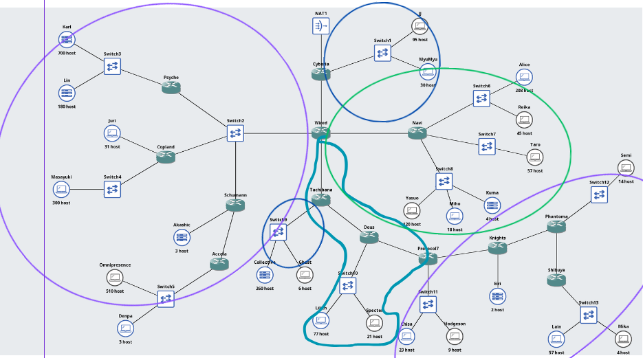
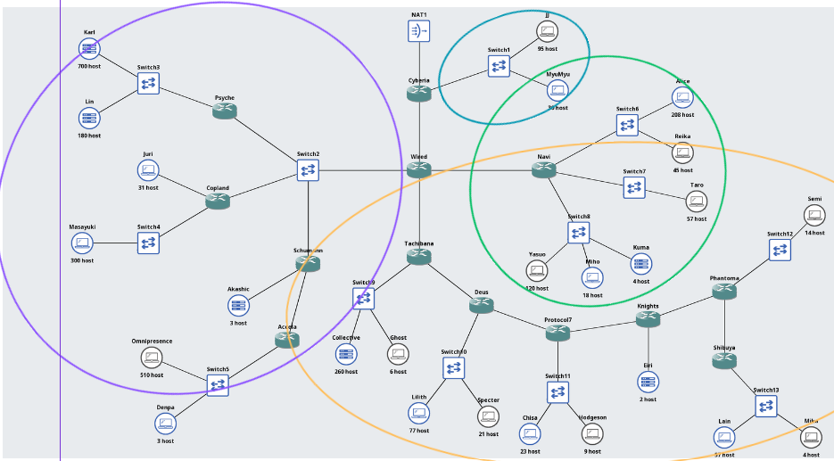
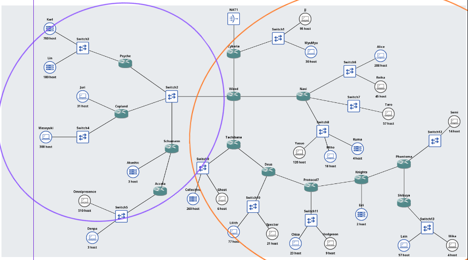
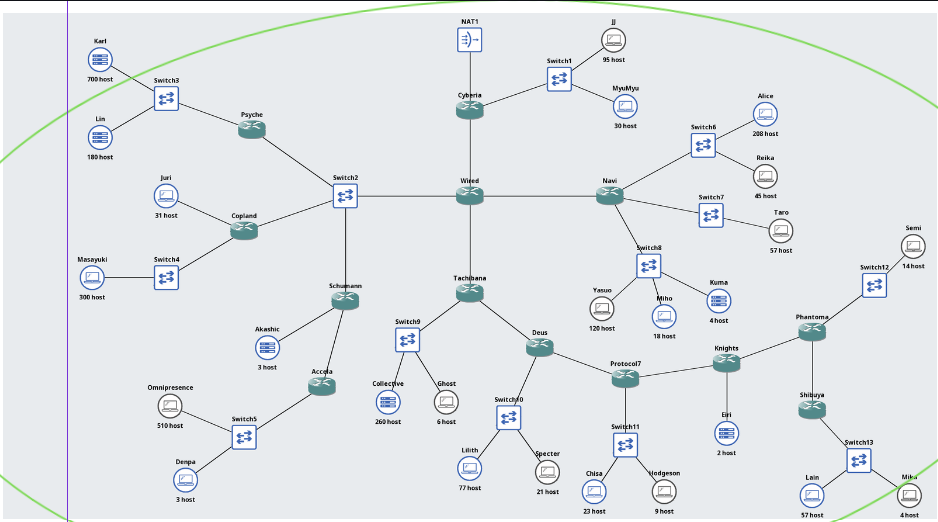
- **Prefix IP:** 192.215.0.0 (blok total 192.215.0.0/19)

## 1. Tabel Rute Dasar

| Subnet | Rute | Jumlah IP | Netmask |
|---|---|---|---|
| A1 | Cyberia > Switch1 > JJ, MyuMyu | 126 | /25 |
| A2 | Cyberia > Wired | 2 | /30 |
| A3 | Wired > Switch2 > Psyche, Copland, Schwann | 4 | /29 |
| A4 | Wired > Navi | 2 | /30 |
| A5 | Wired > Tachibana | 2 | /30 |
| A6 | Psyche > Switch3 > Karl, Lin | 881 | /22 |
| A7 | Copland > Juri | 32 | /26 |
| A8 | Copland > Switch4 > Masayuki | 301 | /23 |
| A9 | Schwann > Akasic | 4 | /29 |
| A10 | Schwann > Accola | 2 | /30 |
| A11 | Accola > Switch5 > Omnipresence, Denpa | 514 | /22 |
| A12 | Navi > Switch6 > Alice, Raika | 254 | /24 |
| A13 | Navi > Switch7 > Taro | 58 | /26 |
| A14 | Navi > Switch8 > Yasuo, Miho, Kuma | 143 | /24 |
| A15 | Tachibana > Switch9 > Collective, Ghost | 267 | /23 |
| A16 | Tachibana > Deus | 2 | /30 |
| A17 | Deus > Switch10 > Lilith, Specter | 99 | /25 |
| A18 | Deus > Protocol7 | 2 | /30 |
| A19 | Protocol7 > Switch11 > Chisa, Hodgeson | 33 | /26 |
| A20 | Protocol7 > Knights | 2 | /30 |
| A21 | Knights > Erl | 3 | /29 |
| A22 | Knights > Phantoma | 2 | /30 |
| A23 | Phantoma > Switch12 > Semi | 15 | /27 |
| A24 | Phantoma > Shibuya | 2 | /30 |
| A25 | Shibuya > Switch13 > Lain, Mika | 62 | /26 |
| **Total** | | **4188** | **/19** |

## 2. Penggabungan CIDR

### B

| Subnet | Gabungan (1) Subnet | Netmask | Gabungan (2) Subnet | Netmask | Netmask Akhir |
|---|---|---|---|---|---|
| B1 | A22 (Knights > Phantoma) | /30 | A24 (Phantoma > Shibuya) | /30 | /29 |
| B2 | A9 (Schwann > Akasic) | /29 | A10 (Schwann > Accola) | /30 | /28 |
| B3 | A19 (Protocol7 > Switch11) | /26 | A20 (Protocol7 > Knights) | /30 | /25 |
| B4 | A16 (Tachibana > Deus) | /30 | A18 (Deus > Protocol7) | /30 | /29 |
| B5 | A4 (Wired > Navi) | /30 | A13 (Navi > Switch7) | /26 | /25 |
| B6 | A12 (Navi > Switch6) | /24 | A14 (Navi > Switch8) | /24 | /23 |
| B7 | A7 (Copland > Juri) | /26 | A8 (Copland > Switch4) | /23 | /22 |
| B8 | A1 (Cyberia > Switch1) | /25 | A2 (Cyberia > Wired) | /30 | /24 |

### C

| Subnet | Gabungan (1) Subnet | Netmask | Gabungan (2) Subnet | Netmask | Netmask Akhir |
|---|---|---|---|---|---|
| C1 | B1 | /29 | A21 (Knights > Erl) | /29 | /28 |
| C2 | B4 | /29 | A5 (Wired > Tachibana) | /30 | /28 |
| C3 | B2 | /28 | A3 (Wired > Switch2) | /29 | /27 |
| C4 | B5 | /25 | B6 | /23 | /22 |
| C5 | A6 (Psyche > Switch3) | /22 | B7 | /22 | /21 |

### D

| Subnet | Gabungan (1) Subnet | Netmask | Gabungan (2) Subnet | Netmask | Netmask Akhir |
|---|---|---|---|---|---|
| D1 | C1 | /28 | A23 (Phantoma > Switch12) | /27 | /26 |
| D2 | C2 | /28 | A17 (Deus > Switch10) | /25 | /24 |
| D3 | C3 | /27 | A11 (Accola > Switch5) | /22 | /21 |

### bebas

| Subnet | Gabungan (1) Subnet | Netmask | Gabungan (2) Subnet | Netmask | Netmask Akhir |
|---|---|---|---|---|---|
| E1 | D1 | /26 | A25 (Shibuya > Switch13) | /26 | /25 |
| E2 | C5 | /21 | D3 | /21 | /20 |
| F1 | B3 | /25 | E1 | /25 | /24 |
| G1 | D2 | /24 | F1 | /24 | /23 |
| H1 | G1 | /23 | A15 (Tachibana > Switch9) | /23 | /22 |
| I1 | C4 | /22 | H1 | /22 | /21 |
| J1 | B8 | /24 | I1 | /21 | /20 |
| K1 | E2 | /20 | J1 | /20 | /19 |

## 3. Pembagian IP CIDR

| Subnet | Network ID | Netmask | Broadcast | Range IP |
|---|---|---|---|---|
| A1 | 192.215.24.0 | 255.255.255.128 | 192.215.24.127 | 192.215.24.1 - 192.215.24.126 |
| A2 | 192.215.24.128 | 255.255.255.252 | 192.215.24.131 | 192.215.24.129 - 192.215.24.130 |
| A3 | 192.215.12.16 | 255.255.255.248 | 192.215.12.23 | 192.215.12.17 - 192.215.12.22 |
| A4 | 192.215.18.64 | 255.255.255.252 | 192.215.18.67 | 192.215.18.65 - 192.215.18.66 |
| A5 | 192.215.20.136 | 255.255.255.252 | 192.215.20.139 | 192.215.20.137 - 192.215.20.138 |
| A6 | 192.215.0.0 | 255.255.252.0 | 192.215.3.255 | 192.215.0.1 - 192.215.3.254 |
| A7 | 192.215.6.0 | 255.255.255.192 | 192.215.6.63 | 192.215.6.1 - 192.215.6.62 |
| A8 | 192.215.4.0 | 255.255.254.0 | 192.215.5.255 | 192.215.4.1 - 192.215.5.254 |
| A9 | 192.215.12.0 | 255.255.255.248 | 192.215.12.7 | 192.215.12.1 - 192.215.12.6 |
| A10 | 192.215.12.8 | 255.255.255.252 | 192.215.12.11 | 192.215.12.9 - 192.215.12.10 |
| A11 | 192.215.8.0 | 255.255.252.0 | 192.215.11.255 | 192.215.8.1 - 192.215.11.254 |
| A12 | 192.215.16.0 | 255.255.255.0 | 192.215.16.255 | 192.215.16.1 - 192.215.16.254 |
| A13 | 192.215.18.0 | 255.255.255.192 | 192.215.18.63 | 192.215.18.1 - 192.215.18.62 |
| A14 | 192.215.17.0 | 255.255.255.0 | 192.215.17.255 | 192.215.17.1 - 192.215.17.254 |
| A15 | 192.215.22.0 | 255.255.254.0 | 192.215.23.255 | 192.215.22.1 - 192.215.23.254 |
| A16 | 192.215.20.128 | 255.255.255.252 | 192.215.20.131 | 192.215.20.129 - 192.215.20.130 |
| A17 | 192.215.20.0 | 255.255.255.128 | 192.215.20.127 | 192.215.20.1 - 192.215.20.126 |
| A18 | 192.215.20.132 | 255.255.255.252 | 192.215.20.135 | 192.215.20.133 - 192.215.20.134 |
| A19 | 192.215.21.0 | 255.255.255.192 | 192.215.21.63 | 192.215.21.1 - 192.215.21.62 |
| A20 | 192.215.21.64 | 255.255.255.252 | 192.215.21.67 | 192.215.21.65 - 192.215.21.66 |
| A21 | 192.215.21.168 | 255.255.255.248 | 192.215.21.175 | 192.215.21.169 - 192.215.21.174 |
| A22 | 192.215.21.160 | 255.255.255.252 | 192.215.21.163 | 192.215.21.161 - 192.215.21.162 |
| A23 | 192.215.21.128 | 255.255.255.224 | 192.215.21.159 | 192.215.21.129 - 192.215.21.158 |
| A24 | 192.215.21.164 | 255.255.255.252 | 192.215.21.167 | 192.215.21.165 - 192.215.21.166 |
| A25 | 192.215.21.192 | 255.255.255.192 | 192.215.21.255 | 192.215.21.193 - 192.215.21.254 |

## 4. IP Interface Router

| Router | Interface | Tujuan | IP / Prefix |
|---|---|---|---|
| Cyberia | eth0 | NAT (DHCP) | DHCP |
| Cyberia | eth1 | Switch1 (A1) | 192.215.24.1/25 |
| Cyberia | eth2 | Wired (A2) | 192.215.24.129/30 |
| Wired | eth0 | Cyberia (A2) | 192.215.24.130/30 |
| Wired | eth1 | Navi (A4) | 192.215.18.65/30 |
| Wired | eth2 | Tachibana (A5) | 192.215.20.137/30 |
| Wired | eth3 | Switch2 (A3) | 192.215.12.17/29 |
| Psyche | eth0 | Switch2 (A3) | 192.215.12.18/29 |
| Psyche | eth1 | Switch3 (A6) | 192.215.0.1/22 |
| Copland | eth0 | Switch2 (A3) | 192.215.12.19/29 |
| Copland | eth1 | Juri (A7) | 192.215.6.1/26 |
| Copland | eth2 | Switch4 (A8) | 192.215.4.1/23 |
| Schwann | eth0 | Switch2 (A3) | 192.215.12.20/29 |
| Schwann | eth1 | Akasic (A9) | 192.215.12.1/29 |
| Schwann | eth2 | Accola (A10) | 192.215.12.9/30 |
| Accola | eth0 | Schwann (A10) | 192.215.12.10/30 |
| Accola | eth1 | Switch5 (A11) | 192.215.8.1/22 |
| Navi | eth0 | Wired (A4) | 192.215.18.66/30 |
| Navi | eth1 | Switch6 (A12) | 192.215.16.1/24 |
| Navi | eth2 | Switch7 (A13) | 192.215.18.1/26 |
| Navi | eth3 | Switch8 (A14) | 192.215.17.1/24 |
| Tachibana | eth0 | Wired (A5) | 192.215.20.138/30 |
| Tachibana | eth1 | Deus (A16) | 192.215.20.129/30 |
| Tachibana | eth2 | Switch9 (A15) | 192.215.22.1/23 |
| Deus | eth0 | Tachibana (A16) | 192.215.20.130/30 |
| Deus | eth1 | Protocol7 (A18) | 192.215.20.133/30 |
| Deus | eth2 | Switch10 (A17) | 192.215.20.1/25 |
| Protocol7 | eth0 | Deus (A18) | 192.215.20.134/30 |
| Protocol7 | eth1 | Knights (A20) | 192.215.21.65/30 |
| Protocol7 | eth2 | Switch11 (A19) | 192.215.21.1/26 |
| Knights | eth0 | Protocol7 (A20) | 192.215.21.66/30 |
| Knights | eth1 | Erl (A21) | 192.215.21.169/29 |
| Knights | eth2 | Phantoma (A22) | 192.215.21.161/30 |
| Phantoma | eth0 | Knights (A22) | 192.215.21.162/30 |
| Phantoma | eth1 | Switch12 (A23) | 192.215.21.129/27 |
| Phantoma | eth2 | Shibuya (A24) | 192.215.21.165/30 |
| Shibuya | eth0 | Phantoma (A24) | 192.215.21.166/30 |
| Shibuya | eth1 | Switch13 (A25) | 192.215.21.193/26 |

## 5. IP Host (semua memakai eth0)

| Host | IP / Prefix | Gateway |
|---|---|---|
| JJ | 192.215.24.2/25 | 192.215.24.1 |
| MyuMyu | 192.215.24.3/25 | 192.215.24.1 |
| Karl | 192.215.0.2/22 | 192.215.0.1 |
| Lin | 192.215.0.3/22 | 192.215.0.1 |
| Juri | 192.215.6.2/26 | 192.215.6.1 |
| Masayuki | 192.215.4.2/23 | 192.215.4.1 |
| Akasic | 192.215.12.2/29 | 192.215.12.1 |
| Omnipresence | 192.215.8.2/22 | 192.215.8.1 |
| Denpa | 192.215.8.3/22 | 192.215.8.1 |
| Alice | 192.215.16.2/24 | 192.215.16.1 |
| Raika | 192.215.16.3/24 | 192.215.16.1 |
| Taro | 192.215.18.2/26 | 192.215.18.1 |
| Yasuo | 192.215.17.2/24 | 192.215.17.1 |
| Miho | 192.215.17.3/24 | 192.215.17.1 |
| Kuma | 192.215.17.4/24 | 192.215.17.1 |
| Collective | 192.215.22.2/23 | 192.215.22.1 |
| Ghost | 192.215.22.3/23 | 192.215.22.1 |
| Lilith | 192.215.20.2/25 | 192.215.20.1 |
| Specter | 192.215.20.3/25 | 192.215.20.1 |
| Chisa | 192.215.21.2/26 | 192.215.21.1 |
| Hodgeson | 192.215.21.3/26 | 192.215.21.1 |
| Erl | 192.215.21.170/29 | 192.215.21.169 |
| Semi | 192.215.21.130/27 | 192.215.21.129 |
| Lain | 192.215.21.194/26 | 192.215.21.193 |
| Mika | 192.215.21.195/26 | 192.215.21.193 |

## 6. Routing

| Router | Tujuan | Next hop | Mewakili |
|---|---|---|---|
| Cyberia | 192.215.0.0/20 | 192.215.24.130 | Sisi barat (A3, A6-A11) |
| Cyberia | 192.215.16.0/21 | 192.215.24.130 | Navi, Tachibana sampai Shibuya |
| Wired | default | 192.215.24.129 | Internet dan A1 |
| Wired | 192.215.0.0/22 | 192.215.12.18 | Psyche (A6) |
| Wired | 192.215.4.0/22 | 192.215.12.19 | Copland (A7, A8) |
| Wired | 192.215.8.0/21 | 192.215.12.20 | Schwann (A9-A11) |
| Wired | 192.215.16.0/22 | 192.215.18.66 | Navi (A12-A14) |
| Wired | 192.215.20.0/22 | 192.215.20.138 | Tachibana (A15-A25) |
| Schwann | 192.215.8.0/22 | 192.215.12.10 | Accola (A11) |
| Tachibana | 192.215.20.0/23 | 192.215.20.130 | Deus (A17-A25) |
| Deus | 192.215.21.0/24 | 192.215.20.134 | Protocol7 (A19-A25) |
| Protocol7 | 192.215.21.128/25 | 192.215.21.66 | Knights (A21-A25) |
| Knights | 192.215.21.128/25 | 192.215.21.162 | Phantoma (A23-A25) |
| Phantoma | 192.215.21.192/26 | 192.215.21.166 | Shibuya (A25) |
| Psyche, Copland, Schwann | default | 192.215.12.17 | Wired |
| Accola | default | 192.215.12.9 | Schwann |
| Navi | default | 192.215.18.65 | Wired |
| Tachibana | default | 192.215.20.137 | Wired |
| Deus | default | 192.215.20.129 | Tachibana |
| Protocol7 | default | 192.215.20.133 | Deus |
| Knights | default | 192.215.21.65 | Protocol7 |
| Phantoma | default | 192.215.21.161 | Knights |
| Shibuya | default | 192.215.21.165 | Phantoma |

## Hasil Pengujian

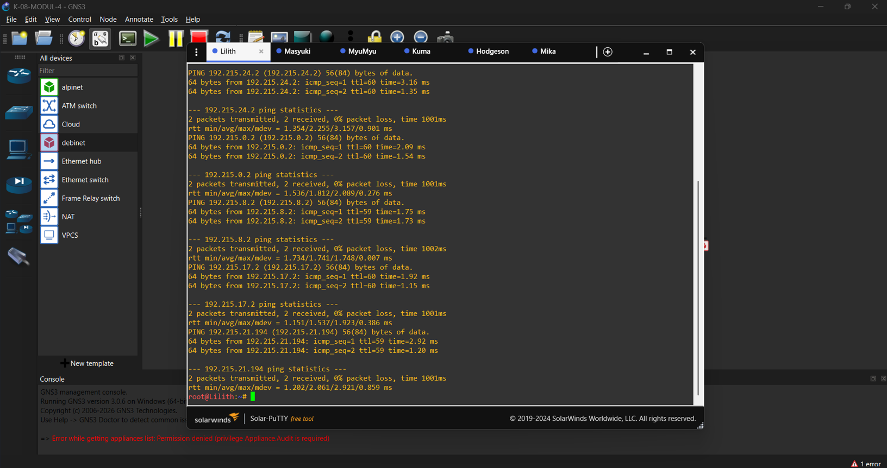
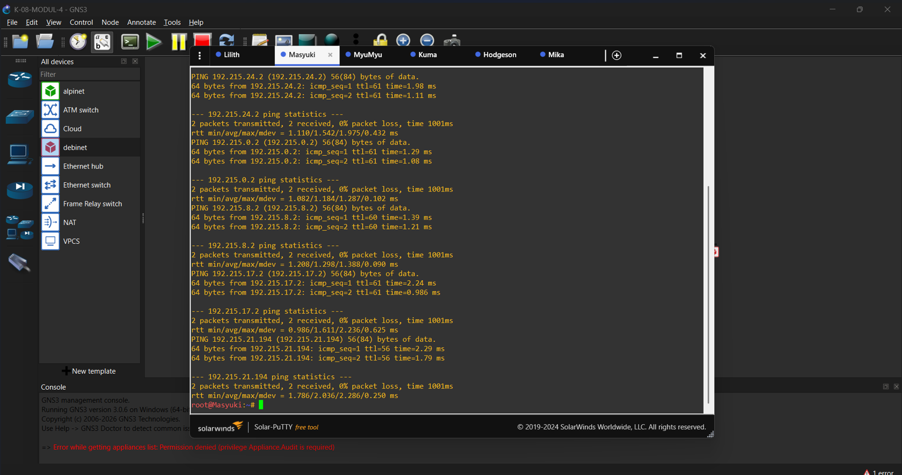
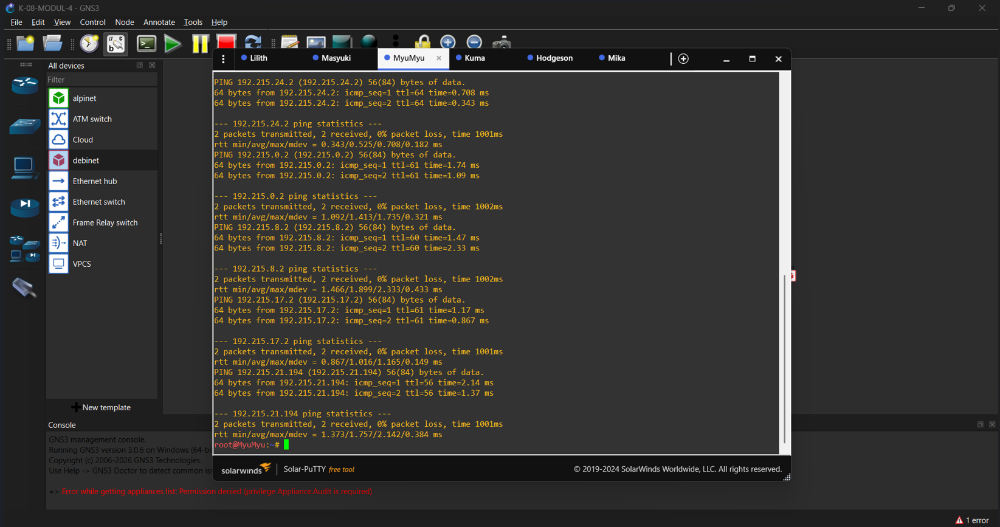
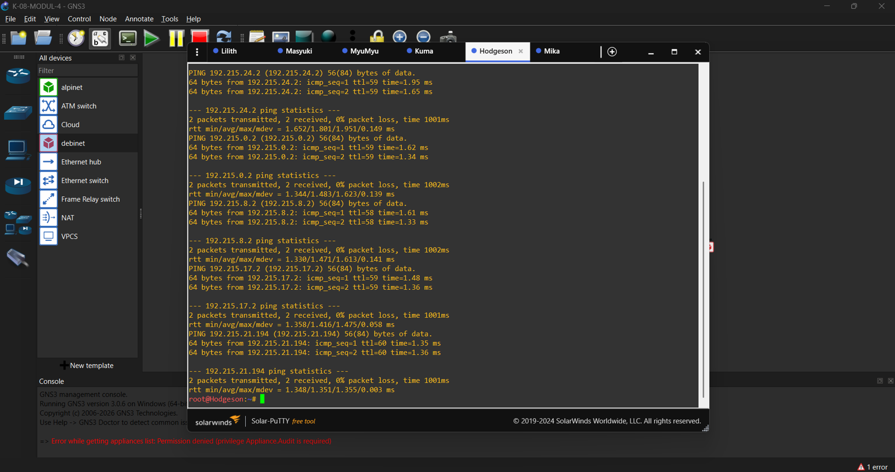
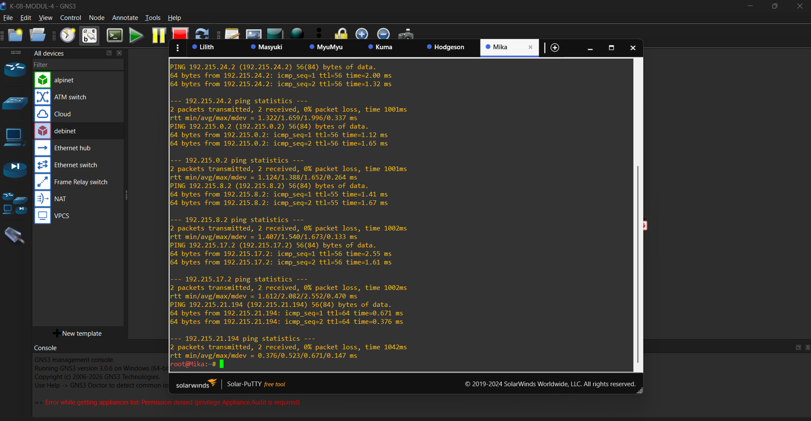